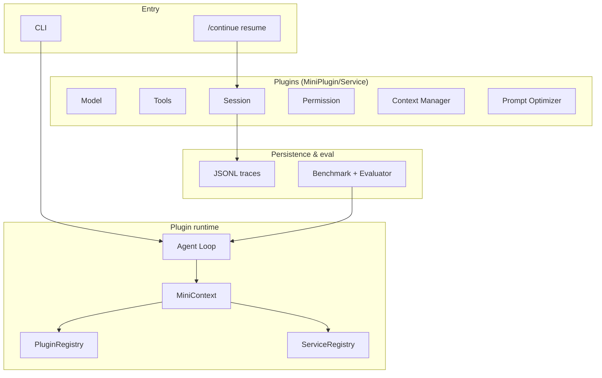

# Mini-dsh

> A plugin-based coding-agent harness in TypeScript/Node.js, inspired by DeepSeek Harness's "everything is a plugin" philosophy. · [中文版](./README.zh-CN.md)

<p align="center">
  
  
  
  
  
</p>

**Mini-dsh** modularizes a coding agent's core capabilities — model, tools, permission, session, context management, prompt optimization, planning, and verification — into **replaceable plugins**, assembled through a unified **MiniContext + Service** protocol into a runnable agent loop. It also ships a **20-task benchmark with ablation studies** that quantify how much each harness mechanism independently contributes.

This is not "yet another script that calls an LLM" — it asks a single question: **which harness mechanisms actually work, and what does each one buy you?**

---

## Features

- **Plugin runtime** — `MiniContext` + `ServiceRegistry` + `EventBus` + `PluginRegistry` (dependency ordering + lifecycle management).
- **Agent loop engine** — ReAct-style `Model → Tool → Result` iterations with budgets (64 model calls / 128 tool calls / 10 min) and `AbortController` cancellation.
- **Unified model abstraction** — `ModelRequest` / `ModelResponse` with DeepSeek + Mock providers, exponential backoff on 429/5xx/network errors, and streaming tool-call aggregation.
- **Coding toolchain** — file read/write, file search, unified diff, `git status` / `git diff`, command execution.
- **Plan & verify** — an observable plan before execution; a verifier feeds structured failure reasons back to the model for self-repair.
- **Session persistence** — append-only JSONL with events and checkpoints; resume with `/continue`.
- **Context Manager & Prompt Optimizer** — 80%-threshold context compression; vague requirements → structured worker prompts.
- **Lightweight permission** — tool allowlist, realpath/symlink protection, sensitive-directory guard, human-in-the-loop confirmation.
- **Zero runtime dependencies** — Node.js built-ins + TypeScript only.

---

## Architecture



| Layer | Responsibility | Key files |
| --- | --- | --- |
| core | plugin assembly, services, events, agent loop | `src/core/*` |
| plugins | model / tools / permission / session / context / optimizer | `src/plugins/*` |
| harness | wires core + plugins into a runnable whole | `src/harness/index.ts` |
| cli / index | command line & public API | `src/cli/*`, `src/index.ts` |
| benchmark / smoke | tasks, evaluator, ablation runs, self-test | `src/benchmark/*`, `src/smoke/*` |

---

## Quick start

> Requires Node.js ≥ 18.

```bash
git clone https://github.com/Moneyxia0525/mini-dsh.git && cd mini-dsh
npm install        # devDependencies only: typescript + @types/node
npm run build      # compiles to dist/
```

Copy the env template and fill in your API key:

```bash
cp .env.example .env
```

```env
DEEPSEEK_API_KEY=sk-xxxxxxxxxxxxxxxx
DEEPSEEK_MODEL=deepseek-chat
DEEPSEEK_BASE_URL=https://api.deepseek.com
```

> Get a key at [platform.deepseek.com](https://platform.deepseek.com/).

Run your first task:

```bash
npm run agent -- "Summarize what src/index.ts exports" --workdir D:\your\project
npm run smoke      # no API key required (MockModel)
npm test           # unit tests
```

---

## Usage

### CLI

```bash
npm run agent -- "Refactor duplicate code in src/" --workdir /path/to/repo
npm run agent -- "any task" --mock
npm run agent -- "fix a bug" --session my-session
npm run agent -- "task" --no-context --no-optimizer   # ablation
```

### API

```ts
import { Harness } from "mini-dsh";

const harness = await Harness.create({
  model: "deepseek",          // or "mock"
  workdir: process.cwd(),
  session: { dir: ".sessions" },
});

const result = await harness.run("Fix the addition bug in src/calc.js");
console.log(result.status, result.metrics, result.finalAnswer);

await harness.dispose();
```

Every capability can be toggled; disabling the Context Manager and Prompt Optimizer reproduces the Benchmark baseline:

```ts
const harness = await Harness.create({
  model: "deepseek",
  workdir: process.cwd(),
  contextManager: false,
  promptOptimizer: false,
});
```

---

## Plugins

| Plugin | Service key | Provides |
| --- | --- | --- |
| `plugin.deepseek-model` | `service.model` | DeepSeek (OpenAI-compatible) calls |
| `plugin.mock-model` | `service.model` | deterministic mock model |
| `plugin.tools` | `service.tools` | file read/write, find/search, patch, git, run_command |
| `plugin.permission` | `service.permission` | allowlist + path constraints + confirmations |
| `plugin.session` | `service.session` | JSONL persistence, events, checkpoints |
| `plugin.context-manager` | `service.context-manager` | context compression & truncation |
| `plugin.prompt-optimizer` | `service.prompt-optimizer` | requirements → worker prompt |
| `plugin.planner` / `plugin.verifier` | `service.planner` / `service.verifier` | planning & verification |

Adding a capability = adding a `MiniPlugin` and registering it once — the agent loop never changes.

```ts
interface MiniPlugin {
  name: string;
  dependsOn?: string[];
  setup(ctx: MiniContext): void | Promise<void>;
  dispose?(): void | Promise<void>;
}
```

---

## Benchmark & ablation

20 tasks across 5 categories (understanding, bug-fix, feature, refactor, test-writing) × 4 configs:

| Config | Composition |
| --- | --- |
| Baseline | bare agent loop (model + basic tools) |
| + Context Manager | baseline + context manager only |
| + Prompt Optimizer | baseline + optimizer only |
| Full Harness | everything enabled |

```bash
npm run benchmark                  # full ablation × 20 tasks
npm run benchmark -- --config full # full config only
npm run benchmark -- --task b1_add # single task
npm run benchmark -- --mock        # pipeline check, no key
```

Six metrics: success rate, avg model turns, avg tool calls, avg tool failures, avg tokens, avg time.

> ⚠️ The table below is a representative example; run `npm run benchmark` to reproduce your own numbers.

| Config | Success | Turns | Tool calls | Tool failures | Tokens |
| --- | --- | --- | --- | --- | --- |
| Baseline | 75% (15/20) | higher | higher | more | more |
| + Context Manager | ↑ | ↓ | ↓ | fewer | lower |
| + Prompt Optimizer | ↑ | ↓ | — | fewer | — |
| **Full Harness** | **90% (18/20)** | lower | lower | fewer | fewer |

---

## Configuration

| Variable | Description | Default |
| --- | --- | --- |
| `DEEPSEEK_API_KEY` | DeepSeek API key (required) | — |
| `DEEPSEEK_MODEL` | `deepseek-chat` / `deepseek-reasoner` | `deepseek-chat` |
| `DEEPSEEK_BASE_URL` | API endpoint (OpenAI-compatible gateways work) | `https://api.deepseek.com` |
| `DEEPSEEK_MAX_RETRIES` | retries for 429/5xx/network | `2` |
| `DEEPSEEK_RETRY_BASE_MS` | backoff base interval (ms) | `300` |
| `MINI_DSH_SESSION_DIR` | JSONL session directory | `.sessions` |

---

## Security

The permission plugin is **in-process policy control, not a sandbox**. It blocks common path escapes, symlink bypasses, and sensitive-directory access — but run untrusted repos or malicious code in an external container or isolated environment.

---

## Roadmap

- [ ] Tool expansion (semantic search, batch edit, test parsing)
- [ ] More model backends (OpenAI, Anthropic, local vLLM)
- [ ] Trace visualization on the JSONL event stream
- [ ] Larger benchmark with public baselines (e.g. SWE-bench subset)
- [ ] Finer-grained path/command allowlists

---

## Contributing

Issues and PRs are welcome. Before changing mechanism-level logic, run the regression suite:

```bash
npm test
npm run benchmark -- --mock
```

---

## License

[MIT](./LICENSE) © 2026

> For learning and technical validation only. Never commit your API key (`.env` is already gitignored).
