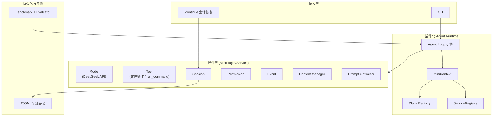
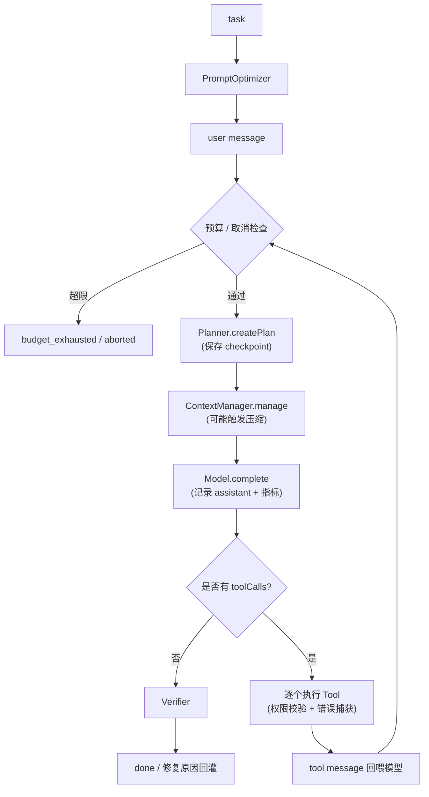

# Mini-dsh

> 基于插件化架构的 Coding Agent Harness —— 参考 DeepSeek Harness「一切皆插件」设计思想，用 TypeScript / Node.js 从零实现。

<p align="center">
  
  
  
  
  
</p>

**Mini-dsh** 把 Coding Agent 的核心能力（模型、工具、权限、会话、上下文管理、Prompt 优化、计划与验证）模块化为**可替换的插件**，通过统一的 **MiniContext + Service 协议**装配成一个可运行的 Agent 执行框架。同时内置 **20 任务 Benchmark 与消融实验（Ablation Study）**，量化不同 Harness 机制对 Agent 执行效果的独立贡献。

不同于"又一个调大模型的脚本"，这个项目的重点是回答一个问题：**Harness 里到底哪些机制真正有效、各自贡献了多少？**

---

## 目录

- [为什么做这个项目](#为什么做这个项目)
- [核心思想](#核心思想)
- [特性](#特性)
- [架构](#架构)
- [目录结构](#目录结构)
- [快速开始](#快速开始)
- [使用方式](#使用方式)
- [插件清单](#插件清单)
- [Benchmark 与消融实验](#benchmark-与消融实验)
- [会话恢复 /continue](#会话恢复-continue)
- [配置项](#配置项)
- [安全边界](#安全边界)
- [Roadmap](#roadmap)
- [设计文档](#设计文档)
- [贡献](#贡献)
- [许可证](#许可证)

---

## 为什么做这个项目

2025–2026 年，编码 Agent 领域经历了一次从「框架」到「Harness」的转向：早期框架（LangChain、AutoGen）提供的是积木，开发者自己写编排；而以 Claude Code、DeepSeek Harness 为代表的 Harness 把「循环」直接做进产品。

「Harness 里哪些机制有效」这类结论往往停留在经验之谈，缺乏量化证据。Mini-dsh 的动机就是**工程验证而非造轮子**：把 Harness 拆成可插拔的模块，再用消融实验为每个机制"记账"——在统一模型、权限与预算的前提下，逐个启用 Context Manager、Prompt Optimizer，观察成功率与成本类指标的变化。这套「设计 → 量化 → 取舍」的闭环，是本项目区别于纯 Demo 的关键。

---

## 核心思想

**Agent = Model + Harness**

- **Model** 只负责认知：给定上下文与工具定义，产出文本或工具调用；
- **Harness** 负责执行：循环推进、工具分发、记忆、权限、上下文管理。

**一切皆插件（Everything is a Plugin）**

所有能力都以 `MiniPlugin` 形式存在，通过 Service key 注入 / 提供，插件之间不直接引用彼此实现，替换任意组件都无需改动 Agent Loop。



---

## 特性

- **插件化运行时**：`MiniContext`（提供 / 注入 / 事件）+ `ServiceRegistry` + `EventBus` + `PluginRegistry`（依赖拓扑排序 + 生命周期管理）。
- **Agent Loop 引擎**：ReAct 式 `Model → Tool → Result` 多轮推进，内置预算控制（默认 64 次模型请求 / 128 次工具调用 / 10 分钟超时）与 `AbortController` 取消。
- **统一模型抽象**：`ModelRequest` / `ModelResponse` 屏蔽 DeepSeek / OpenAI 兼容 API 差异；内置 DeepSeek 与 Mock 两个 provider，支持 429 / 5xx / 网络错误指数退避重试、请求 id 和流式 Tool Call 聚合。
- **Coding Agent 工具链**：文件读写、文件查找、文本搜索、unified diff、`git status` / `git diff`、命令执行。
- **计划与验证**：执行前生成可观测计划，最终回答前运行 Verifier；验证失败会把结构化原因回灌给模型继续修复。
- **Session 持久化**：JSONL 追加写入，保存消息、事件和 checkpoint，支持 `/continue` 续接历史会话。
- **Context Manager**：80% token 阈值触发压缩，按 Tool Calling 消息组保留上下文，工具结果超长截断。
- **Prompt Optimizer**：模糊需求 → 结构化 Worker Prompt。
- **轻量权限**：工具白名单 + 真实路径 / symlink 防绕过 + 敏感目录保护 + human-in-the-loop 确认（不引入 Docker 重隔离）。
- **测试体系**：Smoke Test 之外增加 `node:test` 单元测试，覆盖插件生命周期、参数契约、上下文压缩、Patch 和 Harness 闭环。
- **Benchmark**：20 任务（5 类）× 4 组消融配置，自动化判定，6 类指标汇总。
- **零运行时依赖**：只依赖 Node 原生 API + TypeScript。

---

## 架构

### 分层

| 层 | 职责 | 关键文件 |
| --- | --- | --- |
| 内核（core） | 插件装配、服务注册、事件、Agent 循环 | `src/core/*` |
| 插件（plugins） | 模型 / 工具 / 权限 / 会话 / 上下文 / 优化 | `src/plugins/*` |
| 装配（harness） | 把内核与插件组装成可运行整体 | `src/harness/index.ts` |
| 入口（cli / index） | 命令行 & 公共 API 导出 | `src/cli/*`、`src/index.ts` |
| 评测（benchmark / smoke） | 任务集、Evaluator、消融跑分、冒烟自测 | `src/benchmark/*`、`src/smoke/*` |

### Agent Loop 流程



---

## 目录结构

```
dsh/
├── src/
│   ├── types.ts                  # 全部共享类型契约
│   ├── constants.ts              # Service key / 事件名
│   ├── index.ts                  # 公共 API 导出
│   ├── utils/                    # .env 加载、id、token 估算等
│   ├── core/                     # 内核：Context / 双 Registry / EventBus / AgentLoop
│   ├── harness/                  # 装配层 Harness
│   ├── plugins/
│   │   ├── model/                # DeepSeek + Mock
│   │   ├── tool/                 # 文件操作、搜索、patch、git、run_command
│   │   ├── permission/           # 白名单 + 路径约束
│   │   ├── session/              # JSONL 持久化
│   │   ├── context/              # Context Manager
│   │   ├── optimizer/            # Prompt Optimizer
│   │   ├── plan/                 # 计划服务
│   │   └── verify/               # 验证服务
│   ├── cli/                      # 命令行入口
│   ├── benchmark/                # 20 任务 + Evaluator + 消融跑分
│   ├── smoke/                    # 冒烟测试（无需 API Key）
│   └── tests/                    # node:test 单元测试
├── .env.example
├── package.json
├── tsconfig.json
└── README.md
```

---

## 快速开始

> 要求：Node.js ≥ 18。

### 1. 安装与构建

```bash
git clone https://github.com/Moneyxia0525/mini-dsh.git && cd mini-dsh

# 安装依赖（仅 TypeScript 与 @types/node 两个 devDependencies）
npm install

# 编译到 dist/
npm run build
```

### 2. 配置 DeepSeek API Key

```bash
copy .env.example .env   # Windows；macOS / Linux 用 cp .env.example .env
```

编辑 `.env`，填入你的 API Key：

```env
DEEPSEEK_API_KEY=sk-xxxxxxxxxxxxxxxx
DEEPSEEK_MODEL=deepseek-chat
DEEPSEEK_BASE_URL=https://api.deepseek.com
DEEPSEEK_MAX_RETRIES=2
DEEPSEEK_RETRY_BASE_MS=300
MINI_DSH_SESSION_DIR=.sessions
```

> API Key 在 [platform.deepseek.com](https://platform.deepseek.com/) 获取。

### 3. 跑第一个任务

```bash
# 真实模型（需要 DEEPSEEK_API_KEY）
npm run agent -- "读取 src/index.ts 并总结它导出了哪些模块" --workdir D:\your\project

# 无需 API Key 的链路自测（MockModel）
npm run smoke

# 运行单元测试
npm test
```

---

## 使用方式

### 命令行

```bash
# 指定任务与工作目录
npm run agent -- "重构 src/ 下的重复代码" --workdir /path/to/repo

# 使用 Mock 模型（无需 API Key）
npm run agent -- "任意任务" --mock

# 指定会话 id（便于后续续接）
npm run agent -- "修复 bug" --session my-session

# 禁用某些机制（用于消融实验）
npm run agent -- "任务" --no-context --no-optimizer
```

完整参数见[配置项](#配置项)。

### 编程接口

```ts
import { Harness } from "mini-dsh";

const harness = await Harness.create({
  model: "deepseek",          // 或 "mock"
  workdir: process.cwd(),
  session: { dir: ".sessions" },
});

const result = await harness.run("修复 src/calc.js 的加法 bug");
console.log(result.status, result.metrics, result.finalAnswer);

await harness.dispose();
```

`Harness.create` 支持按需裁剪每个能力，例如关闭 Context Manager 与 Prompt Optimizer（即 Benchmark 的 Baseline 配置）：

```ts
const harness = await Harness.create({
  model: "deepseek",
  workdir: process.cwd(),
  contextManager: false,
  promptOptimizer: false,
});
```

---

## 插件清单

| 插件 | Service key | 能力 |
| --- | --- | --- |
| `plugin.deepseek-model` | `service.model` | DeepSeek（OpenAI 兼容）模型调用与摘要 |
| `plugin.mock-model` | `service.model` | 脚本化确定性模型（自测用） |
| `plugin.tools` | `service.tools` | 文件读写、`find_files` / `search_text` / `apply_patch` / `git_status` / `git_diff` / `run_command` |
| `plugin.permission` | `service.permission` | 工具白名单 + 真实路径约束 + 敏感目录保护 + 人工确认 |
| `plugin.session` | `service.session` | JSONL 追加持久化、事件轨迹与 checkpoint |
| `plugin.context-manager` | `service.context-manager` | 上下文压缩与工具结果截断 |
| `plugin.prompt-optimizer` | `service.prompt-optimizer` | 需求 → 结构化 Worker Prompt |
| `plugin.planner` | `service.planner` | 生成可观测任务计划 |
| `plugin.verifier` | `service.verifier` | 检查最近工具执行结果并触发修复 |

新增一个能力 = 新增一个 `MiniPlugin`，在 `Harness.create` 里注册一次即可，无需改动 Agent Loop：

```ts
interface MiniPlugin {
  name: string;
  dependsOn?: string[];
  setup(ctx: MiniContext): void | Promise<void>;
  dispose?(): void | Promise<void>;
}
```

---

## Benchmark 与消融实验

20 个任务覆盖 5 类代码能力：

| 类别 | 任务数 | 示例 |
| --- | --- | --- |
| 代码理解 | 4 | 读取常量值、统计词数、找默认值、列出 `.md` |
| Bug 修复 | 4 | 加法、FizzBuzz、JSON 解析防护、降序排序 |
| 功能实现 | 4 | sum / factorial / reverse / filterEven |
| 重构 | 4 | 重命名、提取常量、提取校验函数、提取辅助函数 |
| 测试编写 | 4 | 为 math / string / array / bool 写 `node:assert` 测试 |

```bash
# 真实跑分（需 DEEPSEEK_API_KEY）：跑 4 组消融配置 × 20 任务
npm run benchmark

# 只跑 Full Harness 配置
npm run benchmark -- --config full

# 只跑单个任务（调试）
npm run benchmark -- --task b1_add

# 用 MockModel 验证跑分链路（无需 Key，成功率≈0）
npm run benchmark -- --mock
```

**消融实验对照表（4 组配置）**：

| 配置 | 组成 |
| --- | --- |
| Baseline | 裸 Agent Loop（模型 + 基础工具） |
| + Context Manager | Baseline 上单独启用 Context Manager |
| + Prompt Optimizer | Baseline 上单独启用 Prompt Optimizer |
| Full Harness | 全部机制启用 |

6 类指标：**成功率、平均模型轮次、平均工具调用、平均工具失败、平均 Token、平均耗时**。

> ⚠️ 下表为**代表性示例结果**，实际数值随所用模型、任务规模与网络环境而定，运行 `npm run benchmark` 可复现你自己的数据：

| 配置 | 成功率 | 平均轮次 | 平均工具调用 | 平均工具失败 | 平均 Token |
| --- | --- | --- | --- | --- | --- |
| Baseline（无优化） | 75% (15/20) | 较高 | 较高 | 较多 | 较多 |
| + Context Manager | 提升 | 略降 | 略降 | 减少 | 降低 |
| + Prompt Optimizer | 提升 | 略降 | — | 减少 | — |
| **Full Harness** | **90% (18/20)** | 更低 | 更低 | 更少 | 更少 |

---

## 会话恢复 /continue

每次运行会把 `user` / `assistant` / `tool` 记录追加写入 `.sessions/<sessionId>.jsonl`。当任务因预算耗尽中断时，可续接：

```bash
# 第一次运行（指定会话 id）
npm run agent -- "重构 src/ 下的重复代码" --workdir D:\my\repo --session s1

# 预算耗尽后，续接该会话（重置预算、保留历史上下文）
npm run agent -- --continue --session s1
```

每次运行还会记录 `checkpoint`，包含 run id、阶段、计划和指标，便于诊断中断位置。

---

## 配置项

### 命令行参数

| 参数 | 说明 |
| --- | --- |
| `--workdir <path>` | 会话工作目录（默认当前目录） |
| `--session <id>` | 指定会话 id |
| `--session-dir <path>` | JSONL 持久化目录（默认 `.sessions`） |
| `--continue` | 续接指定会话 |
| `--mock` | 使用 MockModel（无需 API Key） |
| `--no-context` | 禁用 Context Manager |
| `--no-optimizer` | 禁用 Prompt Optimizer |
| `--yes` / `-y` | 跳过 human-in-the-loop 确认（自动放行所有命令） |

### 环境变量

| 变量 | 说明 | 默认值 |
| --- | --- | --- |
| `DEEPSEEK_API_KEY` | DeepSeek API Key（必填） | — |
| `DEEPSEEK_MODEL` | 模型名称（`deepseek-chat` / `deepseek-reasoner`） | `deepseek-chat` |
| `DEEPSEEK_BASE_URL` | API 地址（可切换为兼容网关） | `https://api.deepseek.com` |
| `DEEPSEEK_MAX_RETRIES` | 429 / 5xx / 网络错误重试次数 | `2` |
| `DEEPSEEK_RETRY_BASE_MS` | 指数退避基础间隔（毫秒） | `300` |
| `MINI_DSH_SESSION_DIR` | 会话 JSONL 持久化目录 | `.sessions` |

---

## 安全边界

Permission 插件提供的是**进程内策略控制**，不是 Docker 或虚拟机级沙箱。它会阻止常见的路径越界、symlink 绕过和敏感目录访问，并对命令工具提供人工确认；**如果执行不可信仓库或恶意代码，仍应在外部容器或隔离环境中运行**。

---

## Roadmap

- [ ] **工具扩展**：语义检索、批量编辑、测试解析等，覆盖更复杂任务
- [ ] **模型多接入**：在 `ModelRequest/ModelResponse` 抽象上接入 OpenAI、Anthropic、本地 vLLM
- [ ] **轨迹可视化**：基于 JSONL 事件流做时间线视图，直观回放决策过程
- [ ] **Benchmark 扩充**：扩大任务规模，纳入公开基准（如 SWE-bench 子集）做外部对标
- [ ] **权限增强**：更细粒度的路径 / 命令白名单

---

## 设计文档

完整的架构设计与取舍分析见 [`技术设计文档.md`](技术设计文档.md)，涵盖：

- MiniPlugin / Service 协议与双 Registry 设计
- Agent Loop 状态机与预算控制
- Session 与 Context 管理
- Benchmark 与消融实验方法论
- 技术选型与已知局限

---

## 贡献

欢迎提 Issue 与 PR。建议先阅读设计文档了解架构约定，改动机制类逻辑时请跑一遍 Benchmark 回归验证：

```bash
npm test
npm run benchmark -- --mock   # 快速验证链路
```

---

## 许可证

[MIT](./LICENSE) © 2026

> 说明：本项目仅用于学习与技术验证。请勿将 API Key 提交到仓库（`.env` 已在 `.gitignore` 中排除）。
