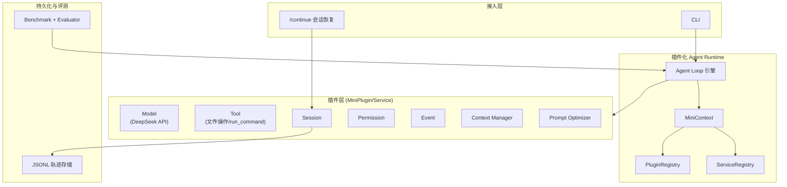
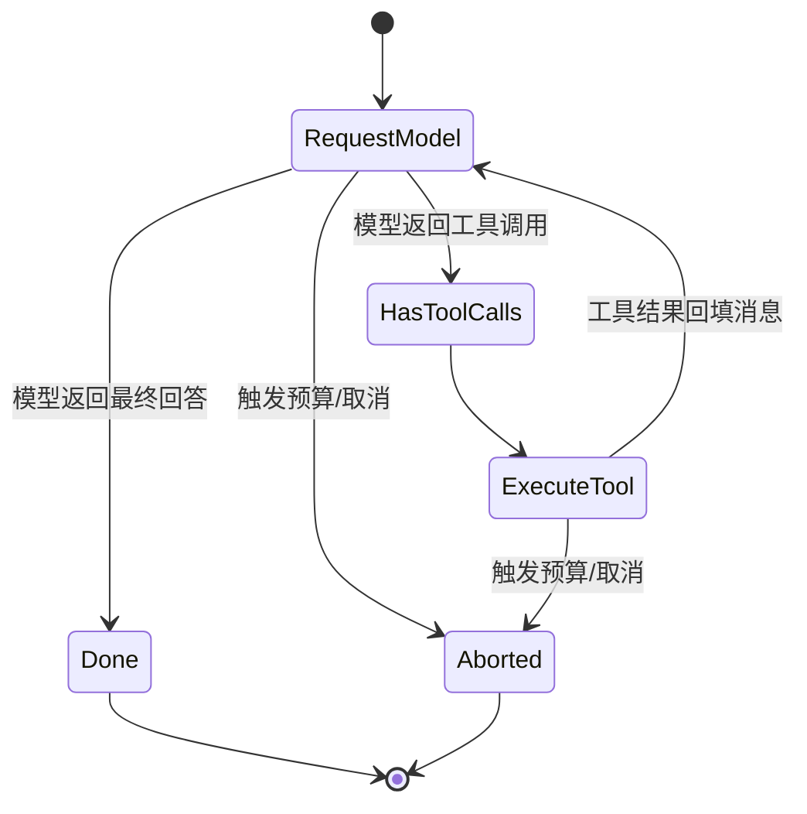

# Mini-dsh — 基于插件化架构的 Coding Agent Harness · 技术设计文档

> **Mini-dsh**：参考 DeepSeek Harness「一切皆插件」的设计思想，用 TypeScript/Node.js 从零实现的轻量级 Coding Agent Harness。将 Agent 的核心能力模块化为可替换插件，并通过 Benchmark 与消融实验，量化不同 Harness 机制对 Agent 执行效果的影响。
>
> 文档定位：项目架构设计蓝图，可直接作为 GitHub 仓库 `README.md` / `docs/DESIGN.md` 使用，也用于简历项目描述与面试讲解。

---

## 1. 项目概述

### 1.1 定位

Mini-dsh 是一个**运行在大模型外层的执行脚手架（Harness）**。模型只做一件事：给定上下文与可用工具列表，预测下一条输出或下一个工具调用。其余一切——循环控制、工具分发、会话持久化、上下文管理、权限约束、事件通知——都由 Harness 承接。

与"又一个 Prompt 调大模型的脚本"不同，Mini-dsh 的核心工作是把这些能力**模块化、可替换化**，并用一套 Benchmark 证明"哪些模块真正提升了效果"。

### 1.2 背景与动机

编码 Agent 领域在 2025–2026 年经历了一次从「框架」到「Harness」的转向：早期框架（LangChain、AutoGen）提供的是积木，开发者自己写编排；而以 Claude Code、DeepSeek Harness 为代表的 Harness 把"循环"直接做进产品。

Mini-dsh 的动机是工程验证而非造轮子：**Harness 里到底哪些机制是有效的、各自贡献了多少？** 这类"机制对执行效果的影响"往往停留在经验之谈，缺乏量化证据。Mini-dsh 通过消融实验（Ablation Study）给出数据支撑。

### 1.3 核心特点

| 特点 | 说明 |
| --- | --- |
| 插件化 Runtime | MiniPlugin/Service 协议 + MiniContext + 双 Registry，核心组件可独立替换 |
| 可控的 Agent Loop | 多轮状态推进 + 预算上限（64 请求 / 128 工具 / 10 分钟）+ 取消机制 |
| 长程会话管理 | JSONL 追加持久化 + 会话恢复 + Context Manager 防上下文膨胀 |
| 可量化验证 | 20-task Benchmark + 自动化 Evaluator + 4 组消融对照 + 6 类指标 |

### 1.4 设计目标与非目标

**目标**

- 插件化：Model、Tool、Session、Permission、Event、Context Manager、Agent Loop 全部可替换，不改执行循环。
- 可控：执行过程有明确的预算上限与取消机制，可安全终止。
- 可恢复：会话全程可持久化、可恢复，预算耗尽后能继续。
- 可量化：任何机制改动都可通过 Benchmark 回归验证。

**非目标**

- 不做自研模型，模型层作为可插拔 Provider（本项目接入 DeepSeek API）。
- 不追求浏览器自动化、多模态等泛化能力，聚焦代码任务。
- 不引入 Docker 等重隔离方案，权限控制由 Permission 插件完成。

---

## 2. 核心设计理念

### 2.1 Agent = Model + Harness

模型负责认知，Harness 负责执行，二者通过标准化的工具调用循环（ReAct 循环，Yao et al., 2022）衔接：

1. Harness 组装 prompt：用户请求 + 系统指令 + 可用工具 schema。
2. 模型返回文本与一个或多个工具调用。
3. Harness 执行工具并捕获结果。
4. Harness 把结果追加回会话，再次调用模型。
5. 循环重复，直到模型给出最终答案，或触发轮次/时间/预算上限。

一个 Harness 是否可靠，取决于包裹在第 3、4 步周围的东西：上下文满了之后如何取舍、权限如何约束、会话如何恢复。

### 2.2 Everything is a Plugin（一切皆插件）

借鉴 DeepSeek Harness 基于 Cordis 内核的「全部可插拔」思想，Mini-dsh 用轻量的 **MiniPlugin/Service 协议**把能力解耦为插件。内核只负责插件的**装配、依赖校验与生命周期管理**，不含业务逻辑。换模型、换工具、换上下文策略，都只替换对应插件，执行循环本身不变。

### 2.3 用消融实验验证设计

架构设计最容易被质疑的地方是"过度设计"——加了一堆机制，但说不清哪个有用。Mini-dsh 的做法是用**消融实验**为每个机制记账：在统一模型、权限与预算的前提下，逐个启用 Context Manager、Prompt Optimizer，观察成功率与成本类指标的变化。这套"设计 → 量化 → 取舍"的闭环，是项目区别于纯 Demo 的关键。

---

## 3. 总体架构

### 3.1 架构图



### 3.2 组件清单

| 组件 | 职责 | 是否插件 |
| --- | --- | --- |
| Agent Loop 引擎 | 驱动 Model → Tool → Result 多轮推进 | 核心（循环策略可替换） |
| MiniContext | 插件运行时上下文，承载双 Registry | 核心 |
| PluginRegistry | 插件注册与生命周期管理 | 核心 |
| ServiceRegistry | Service 注册与依赖注入 | 核心 |
| Model | 统一模型请求/响应抽象 | 是 |
| Tool | 工具执行接口 | 是 |
| Session | JSONL 持久化与恢复 | 是 |
| Permission | 权限约束 | 是 |
| Event | 事件发布/订阅 | 是 |
| Context Manager | 上下文摘要与截断 | 是 |
| Prompt Optimizer | 模糊需求 → Worker Prompt | 是 |

---

## 4. 插件化 Agent Runtime

### 4.1 MiniPlugin/Service 协议

插件化运行时的基石是两个协议。`MiniPlugin` 描述一个可装配、可卸载的模块；`Service` 描述一个可被注入的、提供具体能力的对象：

```typescript
interface MiniPlugin {
  name: string;
  dependsOn?: string[];                 // 依赖的其他 Service key
  setup(ctx: MiniContext): void | Promise<void>;
  dispose?(): void | Promise<void>;     // 热卸载时清理资源
}
```

### 4.2 MiniContext

`MiniContext` 是插件在运行时拿到的唯一上下文，通过它注册服务、注入依赖、收发事件。插件之间不直接引用彼此实现，只通过 key 与事件协作：

```typescript
interface MiniContext {
  provide<T>(key: string, service: T): void;   // 向 ServiceRegistry 注册
  inject<T>(key: string): T;                   // 从 ServiceRegistry 注入（缺失即抛错）
  on(event: string, handler: (payload: unknown) => void): void;
  emit(event: string, payload: unknown): void;
}
```

### 4.3 PluginRegistry 与 ServiceRegistry

两个 Registry 各司其职：

- **PluginRegistry** 管理插件实例的加载、`setup`、`dispose`，即"有哪些插件、处于什么状态"。
- **ServiceRegistry** 管理服务实例的注册与查找，即"谁提供了什么能力、依赖谁"。

装配流程是：内核读配置 → 实例化插件 → 依次执行 `setup`（插件在此 `provide` 自己的服务）→ 全部就绪后开始运行 Agent Loop。

### 4.4 依赖校验、Service 注入与生命周期

- **依赖校验**：插件在 `dependsOn` 声明依赖，装配时做拓扑排序，缺失依赖直接报错，避免运行到一半才暴露问题。
- **Service 注入**：插件通过 `inject(key)` 获取依赖，而非 `new` 出对方实例，保证可替换性。
- **生命周期管理**：内核统一管理 `setup → 运行 → dispose`，卸载插件时能正确释放资源（如关闭文件、停止定时器）。

### 4.5 被解耦的组件

通过这套协议，以下组件被解耦为独立插件，替换任意一个都无需改动 Agent Loop：

Model（DeepSeek API 接入）、Tool（文件操作与命令执行）、Session（JSONL 持久化）、Permission（权限）、Event（事件通知）、Context Manager（上下文管理）、Agent Loop（循环策略本身也可换）。

---

## 5. Agent Loop 与工具执行

### 5.1 Model → Tool → Result 状态推进

Agent Loop 是 Harness 的主循环，用显式状态机描述一轮推进：



每一轮都严格遵循"请求模型 → 解析工具调用 → 执行工具 → 回填结果 → 再请求"的推进方式，直到任务完成或预算耗尽。

### 5.2 预算与取消控制

为防止长任务失控，Agent Loop 内置四层约束：

| 约束 | 阈值 | 作用 |
| --- | --- | --- |
| 模型请求上限 | 64 次 | 限制"请求模型"轮数 |
| 工具调用上限 | 128 次 | 限制工具执行次数 |
| 任务超时 | 10 分钟 | 硬性时间上限 |
| 取消信号 | AbortController | 支持随时中断，优雅终止 |

`AbortController` 贯穿整个循环与工具执行，取消时能中止正在进行的模型请求与工具调用，而非等到下轮才退出。

### 5.3 ModelRequest/ModelResponse 统一抽象

屏蔽各家 API 差异，基于原生 Tool-Calling 能力抽象统一接口：

```typescript
interface ModelRequest {
  messages: Message[];
  tools: ToolDefinition[];
  signal: AbortSignal;
}

interface ModelResponse {
  content: string | null;       // 纯文本输出
  toolCalls: ToolCall[];        // 结构化工具调用
  usage: TokenUsage;            // token 统计
}
```

上层 Agent Loop 只面向 `ModelRequest/ModelResponse` 编程，替换模型 Provider 不影响循环逻辑。

### 5.4 Tool-Calling 映射

模型返回的结构化 Tool-Calling 被映射到统一的工具执行接口：解析工具名与参数 → 校验参数 → 交给对应工具执行 → 把结果与错误统一封装为消息回填。映射层同时处理"模型返回了未注册工具""参数非法"等异常，将其转为可回喂给模型的错误消息。

### 5.5 基础工具

MVP 阶段提供两类基础工具，足够覆盖 Benchmark 中的代码任务：

- **文件操作**：读取、写入、列出目录，读取带行号、分块返回，控制输出长度避免噪声。
- **run_command**：在会话工作目录执行命令（运行测试、构建、git 等），返回结构化输出与退出码。

### 5.6 Permission 插件

不引入 Docker 等重隔离方案，而是用 **Permission 插件**做权限约束：定义工具与路径的允许范围，在工具执行前校验，越界直接拒绝。权限策略同样是插件，可按会话、按任务动态替换。

---

## 6. Session 与 Context 管理

### 6.1 JSONL 追加持久化

会话以**追加式 JSONL** 持久化：每条消息、每个工具调用、每个工具结果都作为一行 JSON 追加写入。追加式写法的好处是——顺序天然就是时间线，崩溃恢复只需回读文件，无需事务。

```jsonl
{"kind":"user","content":"修复 utils/parse.ts 的空指针崩溃","ts":1718000000000}
{"kind":"assistant","toolCalls":[{"name":"read_file","arguments":"{\"path\":\"utils/parse.ts\"}"}],"ts":1718000001000}
{"kind":"tool","name":"read_file","result":"...","ts":1718000001500}
```

### 6.2 Session 恢复与 /continue

基于 JSONL 全量记录，会话支持两点能力：

- **恢复**：重新载入 JSONL 重建完整消息历史，从任意中断点继续。
- **/continue**：当预算（64 请求 / 128 工具 / 10 分钟）耗尽后，用户可执行 `/continue` 续接——重置预算计数器、保留已有上下文，让任务接着做下去，而非从头再来。

### 6.3 Context Manager

长程任务里上下文会持续膨胀，Context Manager 用阈值触发的方式缓解：

- **触发条件**：上下文占用达到阈值（本项目取 80%）时触发压缩。
- **摘要压缩**：用模型把较早的历史生成摘要，替代原始消息。
- **保留窗口**：仅保留最近 **12 条**消息的完整内容，更早的折叠为摘要。
- **结果截断**：对大体积工具结果（如长文件、长日志）先截断，超过部分不进上下文。

这套机制的收益在 §7.5 的消融实验中有量化对比。

### 6.4 Prompt Optimizer

用户输入常是模糊的自然语言需求，直接作为任务约束会导致模型反复试探、浪费轮次。Prompt Optimizer 插件把**模糊需求转换为可执行的 Worker Prompt**：补全目标、约束、验收标准、工作目录等要素，产出结构化的任务指令，再交给 Agent Loop 执行，减少因约束不明确带来的无效执行。

---

## 7. Benchmark 设计与消融实验

### 7.1 20-task Benchmark

自建 20 个任务，覆盖五类代码能力，与"代码生成/审查/修改"的诉求一一对应：

| 任务类别 | 数量 | 对应能力 |
| --- | --- | --- |
| 代码理解 | 若干 | 定位、解释既有代码 |
| Bug 修复 | 若干 | 代码修改 |
| 功能实现 | 若干 | 代码生成 |
| 重构 | 若干 | 代码修改 |
| 测试编写 | 若干 | 代码生成 |

每个任务给出明确的工作目录、验收条件与判定标准，保证可复现。

### 7.2 自动化 Evaluator

每个任务配自动化 Evaluator，通过运行测试、比对输出、检查文件产物等方式给出客观的"成功/失败"判定，避免人工打分的主观性。Evaluator 与 Benchmark 绑定，跑分结果可重复。

### 7.3 消融实验设计

在**统一模型、权限与预算**的前提下，对四组配置做对照：

| 配置 | 组成 |
| --- | --- |
| Baseline | 裸 Agent Loop（模型 + 基础工具），无 Context Manager、无 Prompt Optimizer |
| + Context Manager | Baseline 基础上单独启用 Context Manager |
| + Prompt Optimizer | Baseline 基础上单独启用 Prompt Optimizer |
| Full Harness | 全部机制启用 |

通过"逐个启用"的方式，把每个机制的独立贡献从整体效果中剥离出来。

### 7.4 指标体系

共 6 类指标，兼顾"做没做对"与"花多大代价"：

1. **成功率**（Success Rate）
2. **Model Rounds**（平均模型响应次数）
3. **Tool Calls**（工具调用次数）
4. **Tool Errors**（工具失败次数）
5. **Token**（消耗 token 数）
6. **Latency**（延迟）

### 7.5 实验结果与分析

| 配置 | 成功率 |
| --- | --- |
| Baseline | 75%（15/20） |
| Full Harness | 90%（18/20） |

Full Harness 相较 Baseline 成功率提升 15 个百分点（多解决 3 个任务），同时平均模型响应次数、工具失败次数与 token 消耗均有下降。这说明 Context Manager 与 Prompt Optimizer 的组合不仅没有牺牲效率，反而在"少走弯路"上产生了正收益——更少的无效轮次、更少的失败工具调用、更省的 token，最终转化为更高的成功率。

---

## 8. 数据模型与接口定义

```typescript
// 消息与工具调用
interface Message {
  role: "system" | "user" | "assistant" | "tool";
  content: string;
  toolCallId?: string;
  toolCalls?: ToolCall[];
}

interface ToolCall {
  id: string;
  name: string;
  arguments: string;         // JSON 序列化参数
}

// 工具定义与执行结果
interface ToolDefinition {
  name: string;
  description: string;
  parameters: Record<string, unknown>;   // JSON Schema
}

interface ToolResult {
  output: string;
  error?: string;
}

// 统一模型接口（见 §5.3）
interface ModelRequest { /* ... */ }
interface ModelResponse { /* ... */ }

// 插件协议（见 §4.1）
interface MiniPlugin { /* ... */ }
interface MiniContext { /* ... */ }
```

---

## 9. 技术栈选型

| 层 | 选型 | 理由 |
| --- | --- | --- |
| 语言 | TypeScript / Node.js | 类型系统支撑插件协议与配置校验；与 DeepSeek Harness 的 Cordis 生态同栈 |
| 模型接入 | DeepSeek API | 原生 Tool-Calling + 前缀缓存友好，成本低 |
| 持久化 | JSONL | append-only 天然适配轨迹记录，恢复简单 |
| 插件运行时 | 自研 MiniContext + 双 Registry | 展示对插件内核的理解，避免黑盒依赖 |
| 评测 | 自建 20-task + Evaluator | 覆盖五类代码任务，客观可复现 |

---

## 10. 后续可扩展方向

- **工具扩展**：新增语义检索、批量编辑、测试解析等工具，覆盖更复杂任务。
- **模型多接入**：在 ModelRequest/ModelResponse 抽象上接入更多 Provider（OpenAI、Anthropic、本地 vLLM）。
- **轨迹可视化**：基于 JSONL 事件流做时间线视图，直观回放决策过程。
- **Benchmark 扩充**：扩大任务规模，纳入公开基准（如 SWE-bench 子集）做外部对标。
- **权限增强**：在 Permission 插件上叠加更细粒度的路径/命令白名单。

---

## 11. 设计取舍与已知局限

- **轻隔离 vs 强隔离**：用 Permission 插件而非 Docker，换来部署简单、启动快，代价是隔离强度依赖插件实现，不能保证对抗恶意代码。
- **阈值策略的普适性**：Context Manager 的 80% 阈值与 12 条窗口是针对当前模型与任务规模调的参数，换模型或更长任务可能需要重新标定。
- **Benchmark 规模**：20 个任务是自建集，结论有代表性但样本有限，外推需谨慎。
- **消融的口径**：成功率 90% vs 75% 的对比在统一预算下成立，但"省 token"与"多解决任务"之间的因果，需结合每任务的轮次/失败明细进一步拆分。

---

## 12. 简历呈现建议

简历建议用**一行定位 + 三点成果**的结构，把"做了什么"落到可验证的数字：

- **定位**：基于插件化架构（MiniPlugin/Service）的 Coding Agent Harness，参考 DeepSeek Harness「一切皆插件」思想，用 TypeScript/Node.js 从零实现。
- **成果**：设计 PluginRegistry/ServiceRegistry 解耦 Model/Tool/Session/Permission/Event/Context Manager/Agent Loop；自建 20-task Benchmark 做消融实验，Full Harness 成功率 90%（18/20）vs Baseline 75%（15/20），模型轮次、工具失败与 token 均下降。
- **技术关键词**：插件化 Runtime、依赖注入、Agent Loop、Tool-Calling、JSONL 会话恢复、Context 摘要压缩、消融实验、Benchmark。

面试时最有说服力的讲法不是"我用了什么技术"，而是"我如何量化每个 Harness 机制的贡献、如何取舍"——§7 的消融实验与 §11 的取舍正是这条叙事的核心素材。
